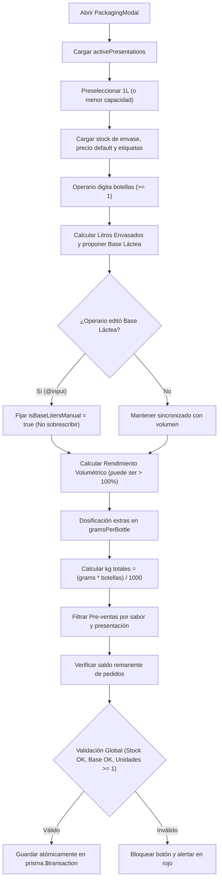

# Plan de Arquitectura — Spec 011: Modal Dinámico de Envasado en Fase B

Estado: borrador (esperando aprobación del usuario)

## 1. Resumen de Arquitectura y Enfoque de Solución

La **Spec 011** moderniza el flujo de envasado y fraccionamiento de producto terminado (Fase B) eliminando el esquema rígido y manual previo, sustituyéndolo por un modelo **Mono-Presentación por Fracción** gobernado por pestañas dinámicas conectadas al catálogo de presentaciones activas (`ProductPresentation`).

### Principios Arquitectónicos Clave:
1. **Mono-Presentación y Verdad Única en JSON `containers` (Constitución Art. 1.1 y 5.4)**:
   - Toda nueva fracción de envasado en Fase B (`BatchPackaging`) se estructurará con una única presentación comercial en `containers: [{ containerName, capacityLiters, quantity, price, rawMaterialId }]`.
   - Las columnas legacy `bottles1L` y `bottles2L` solo se poblarán pasivamente como reflejo numérico sin lógica activa de negocio.
2. **Expansión Volumétrica y Rendimiento Legítimo $> 100\%$ (Constitución Art. 5.6)**:
   - La base láctea consumida (`baseLitersUsed`) representa el yogur blanco líquido extraído del tanque madre de Fase A.
   - El volumen envasado en botellas puede superar legítimamente la base láctea debido al aporte volumétrico y de masa de mermeladas, frutas y almíbares. El sistema respeta el valor fijado por el operario (`isBaseLitersManual`) sin forzar igualdad matemática ni sobrescribirlo.
3. **Dosificación Exacta por Envase (`gramsPerBottle`)**:
   - Para materias primas pesables (kg/g): el formulario solicita la dosis en gramos por botella según la presentación (ej. 75 g para 500 ml).
   - El total a descontar en almacén se computa como $\frac{\text{dosis (g)} \times \text{botellas}}{1000}$ en kg.
   - Al backend se envía tanto la cantidad en kg como `dosagePerLiter = round(gramsPerBottle / capacityLiters, 2)` para respaldar la rehidratación.
4. **Pre-ventas Atómicas con Saldo Remanente**:
   - Las órdenes pendientes se filtran por sabor y por la presentación activa.
   - Se calcula reactivamente el saldo remanente de botellas libres, inhabilitando pedidos que excedan dicho saldo.
5. **Transaccionalidad Atómica y Ajuste Diferencial (Constitución Art. 6.2 y 9.2)**:
   - Creación y edición se encapsulan en `prisma.$transaction`.
   - La edición mono-presentación aplica el diferencial neto ($\text{newDelta} - \text{oldDelta}$) en inventario y bloquea si la nueva cantidad es menor a las botellas ya entregadas.
6. **Diseño Frontend en 3 Capas Fijas (Constitución Art. 10.2)**:
   - Cabecera fija (`header shrink-0`), cuerpo desplazable (`flex-1 min-h-0 overflow-y-auto`), pie fijo (`footer shrink-0`).

---

## 2. Capas y Archivos Afectados

### Backend (Node.js / Express / Prisma / Zod)
1. [`src/modules/batches/batches.schema.ts`](file:///c:/Users/edier/Documents/YOGURES/src/modules/batches/batches.schema.ts):
   - Extender `packagingExtraItemSchema` para aceptar opcionalmente `gramsPerBottle: z.coerce.number().min(0).optional()`.
   - Extender `batchPackagingSchema` y `updateBatchPackagingSchema` para asegurar que el precio admita $\ge 0$ y soportar la estructura canónica de `containers`.
2. [`src/modules/batches/batches.service.ts`](file:///c:/Users/edier/Documents/YOGURES/src/modules/batches/batches.service.ts):
   - **`createBatchPackaging`**:
     - Consumir el envase dinámico de `containers` y verificar stock disponible en almacén (`currentStock >= quantity`).
     - Descontar etiquetas si `useLabels = true` con validación de stock; omitir si `useLabels = false`.
     - Descontar insumos extras calculados en kg a partir de `gramsPerBottle` o `quantityUsed`, validando existencias de bodega.
     - Respetar `baseLitersUsed` provisto por el operario, validándolo contra el saldo del tanque madre sin bloquear rendimientos $> 100\%$.
     - Vincular pedidos seleccionados atómicamente a nivel de ítem.
   - **`updateBatchPackaging`**:
     - Inmutabilidad de la presentación: impedir alteración del formato de envase en fracciones mono-presentación existentes.
     - Ajuste diferencial neto en Kardex: $\Delta = \text{new} - \text{old}$ para envases, etiquetas y fruta. Si $\Delta = 0$, permitir guardar sin exigir stock adicional.
     - Validación contra entregas: bloquear si $\text{nuevasBotellas} < \text{botellasEntregadas}$ o emitir advertencia si reduce cobertura de pedidos en preparación.
     - Ajuste diferencial de `baseLitersUsed` contra el tanque madre.

### Frontend (Vue 3 / Composition API / Tailwind / Pinia)
3. [`frontend/src/components/production/PackagingModal.vue`](file:///c:/Users/edier/Documents/YOGURES/frontend/src/components/production/PackagingModal.vue):
   - Refactorizar la estructura a 3 capas fijas (`header`, `body min-h-0 overflow-y-auto`, `footer`).
   - Eliminar el botón "Agregar nueva presentación" y la sección legacy de "Otras presentaciones opcionales".
   - Implementar selector de pestañas dinámico basado en `productionStore.activePresentations`, con selección inicial en 1L (o menor capacidad determinista).
   - Campo unificado de unidades/botellas con cálculo volumétrico y validación de enteros $\ge 1$.
   - Reactividad de base láctea con bandera `isBaseLitersManual`:
     - Sincronización automática mientras no se edite.
     - Preservación del valor manual al ingresar por teclado (`@input`).
     - Cálculo de rendimiento volumétrico con protección contra división por cero (`0%` si base es 0).
   - Insumos extras:
     - Opcionales para sabor 'Natural' o sin adiciones.
     - Captura en `gramsPerBottle` para insumos pesables con rotulado dinámico contextual (ej. `g / botella (500ml)`).
     - Limpieza de dosis al alternar de pestaña.
     - Bloqueo de guardado (`stockOk = false`) si falta stock de envase, etiquetas activas o fruta.
   - Pre-ventas:
     - Filtro por sabor y presentación activa (soporte de ítems específicos en pedidos multisabor/multipresentación).
     - Saldo remanente dinámico: deshabilitar checkboxes de pedidos que excedan las botellas libres restantes.
     - Reinicio de selección al cambiar de pestaña.
   - Modo edición:
     - Fracción histórica mixta (1L + 2L): banner de solo lectura/auditoría.
     - Fracción mono-presentación: pestañas bloqueadas/fijas, rehidratación exacta de `gramsPerBottle` desde kg consumidos, y validación contra botellas entregadas.

### Pruebas Automatizadas (Vitest / Supertest)
4. [`tests/dynamic_packaging_fase_b.test.ts`](file:///c:/Users/edier/Documents/YOGURES/tests/dynamic_packaging_fase_b.test.ts):
   - Suite completa dedicada a la Spec 011 cubriendo los requisitos RF-1 a RF-18 y casos límite CL-1 a CL-6.

---

## 3. Diagrama de Flujo del Modal Dinámico

---

## 4. Estrategia de Pruebas y TDD (Prove-It Pattern)

Conforme a la regla innegociable de TDD (`AGENTS.md`), cada tarea de implementación se desarrollará escribiendo primero la prueba que falle en rojo, implementando el código mínimo para ponerla en verde y refactorizando:

1. **Test 1 (Rojo)**: Creación de fracción mono-presentación de 500 ml con persistencia canónica en `containers` y cálculo volumétrico exacto.
2. **Test 2 (Rojo)**: Dosificación en gramos por envase para insumos pesables, conversión a kg y verificación de descuento exacto en Kardex.
3. **Test 3 (Rojo)**: Rendimiento volumétrico superior al 100% por adición de fruta/almíbar sin error de sobrecupo.
4. **Test 4 (Rojo)**: Bloqueo estricto por insuficiencia de stock de envases, etiquetas activas o fruta.
5. **Test 5 (Rojo)**: Filtrado atómico de pre-ventas y control de saldo remanente libre para evitar sobreventa.
6. **Test 6 (Rojo)**: Edición mono-presentación con inmutabilidad de presentación, ajuste diferencial ($\text{newDelta} - \text{oldDelta}$) y bloqueo si $\text{nuevasBotellas} < \text{entregadas}$.

---

## 5. Análisis de Riesgos y Mitigación

| Riesgo Técnico / Operativo | Impacto | Mitigación Arquitectónica |
| :--- | :--- | :--- |
| **Inconsistencia de Kardex al editar cantidades** | Alto | Aplicación del diferencial neto ($\text{newDelta} - \text{oldDelta}$) en una única transacción interactiva de Prisma. |
| **División por cero en rendimiento volumétrico** | Bajo | Operador ternario reactivo `baseLitersUsed > 0 ? round(...) : 0` en frontend y backend. |
| **Sobreventa en vinculación de pedidos** | Medio | Cálculo reactivo de saldo remanente libre: el checkbox se deshabilita si el pedido demanda más botellas de las que quedan disponibles. |
| **Pérdida de datos en fracciones históricas mixtas** | Alto | Detección de lotes con $> 1$ presentación en `containers` o con `bottles1L > 0 && bottles2L > 0` para activar modo solo lectura/auditoría. |
| **Desbordamiento visual en pantallas móviles** | Medio | Arquitectura estricta de 3 capas fijas (`header`, `body min-h-0 overflow-y-auto`, `footer`), con pestañas adaptativas y `flex-wrap`. |

---

## 6. Criterios de Aceptación y Quality Gates

- `npx tsc --noEmit` ejecuta con 0 errores en backend.
- `npm --prefix frontend run build` genera el bundle de producción sin advertencias de tipado.
- Suite `tests/dynamic_packaging_fase_b.test.ts` pasando 100% en verde con Vitest.
- Interfaz verificada en modo claro y oscuro, respetando la estructura de 3 capas.
