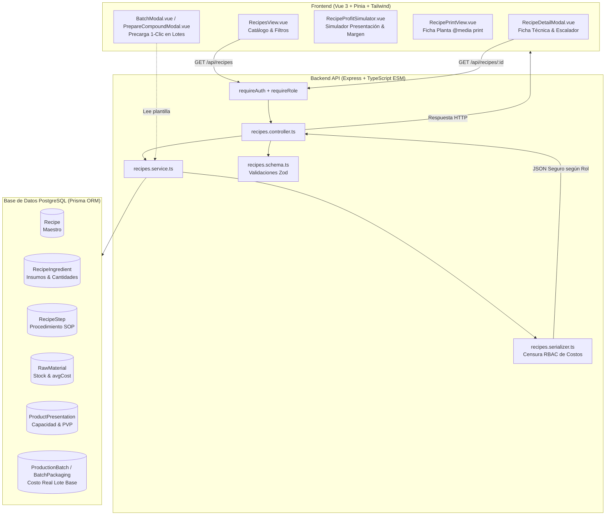

# Plan de Arquitectura — Spec 015: Libro de Recetas y Estandarización de Producción

Estado: aprobado

## 1. Resumen Ejecutivo y Objetivos Técnicos
El presente plan describe la arquitectura técnica para implementar el **Libro de Recetas (Recetario Maestro / SOP)** en YogurArte. Este módulo estandariza las formulaciones de **Elaboraciones** (mermeladas con merma por evaporación), **Fase A** (fermentación de base láctea a granel) y **Fase B** (saborización universal desacoplada de presentaciones comerciales).

### Objetivos Clave de Diseño
1. **Desacoplamiento de Sabor y Presentación en Fase B:** Formular por sabor (proporciones de base líquida y mermelada por litro terminado) y resolver dinámicamente en el cliente el empaque (`BOTELLA_*` y `ETIQUETA_*`, recordando que el envase comercial ya incluye su tapa integrada de fábrica) y margen comercial mediante un **Simulador Interactivo de Rentabilidad** conectado al catálogo dinámico `ProductPresentation`.
2. **Confidencialidad RBAC Estricta:** Censurar a nivel de servicio y serializador en la API (`sanitizeRecipeForRole`) cualquier dato de costo promedio, costo total, costo de empaque, precio de venta, utilidad y margen cuando el usuario solicitante no sea `ADMIN` o `SOCIO`.
3. **Escalador Dinámico y Tiempos Biológicos Inmutables:** Recalcular insumos reactivamente ($\text{Cantidad Objetivo} / \text{Rendimiento Base}$), preservando fijos los tiempos biológicos de incubación y enfriamiento.
4. **Integración con Producción sin Afectar Recetas Maestras:** Cargar recetas con 1 clic en los modales de envasado (`BatchModal.vue`) y elaboraciones (`PrepareCompoundModal.vue`) como plantillas base editables in situ para la orden de trabajo, validando insumos activos y manteniendo inalterables las recetas maestras.
5. **Auditoría e Inmutabilidad Histórica:** Vincular autoría en `User.id` (Art. 2 Constitución). Prohibir borrado físico de recetas con uso histórico (`status = ARCHIVADA`). Persistencia atómica mediante transacciones de Prisma (`prisma.$transaction`, Art. 9.2).

---

## 2. Diagrama de Arquitectura y Flujo de Datos



---

## 3. Modelo de Datos Prisma

Se crearán 3 nuevos modelos en `prisma/schema.prisma` y se añadirán las relaciones inversas correspondientes:

### 3.1. Modelo `Recipe`
```prisma
model Recipe {
  id              Int                @id @default(autoincrement())
  code            String             @unique // ej: REC-MERM-FRESA, REC-FASEA-BASE, REC-FASEB-FRESA-TRAD
  name            String             // ej: Mermelada Artesanal de Fresa
  category        String             // ELABORACION, FASE_A, FASE_B
  flavor          String?            // Sabor asociado (Fase B o Elaboraciones), ej: Fresa, Mora, Melocotón
  outputMaterialId Int?              // Obligatorio para ELABORACION: apunta al RawMaterial compuesto que produce
  outputMaterial  RawMaterial?       @relation("RecipeOutputMaterial", fields: [outputMaterialId], references: [id])
  description     String?            @db.Text
  baseYield       Float              @default(1) // Volumen (L) o Masa (kg) obtenido
  yieldUnit       String             @default("Litros") // Litros, Kilogramos, Unidades
  baseLiters      Float?             @default(0) // Requerido para FASE_B: Litros de base láctea fermentada
  status          String             @default("ACTIVA") // ACTIVA, ARCHIVADA
  createdById     Int
  createdBy       User               @relation(fields: [createdById], references: [id])
  createdAt       DateTime           @default(now())
  updatedAt       DateTime           @updatedAt
  ingredients     RecipeIngredient[]
  steps           RecipeStep[]
  batchesUsing    ProductionBatch[]  @relation("BatchRecipe")
  packagingsUsing BatchPackaging[]   @relation("PackagingRecipe")
  preparationsUsing SupplyPreparation[] @relation("PreparationRecipe")

  @@index([category])
  @@index([status])
  @@index([flavor])
  @@index([outputMaterialId])
  @@index([createdById])
  @@index([category, status])
}
```

### 3.2. Modelo `RecipeIngredient`
```prisma
model RecipeIngredient {
  id            Int          @id @default(autoincrement())
  recipeId      Int
  recipe        Recipe       @relation(fields: [recipeId], references: [id], onDelete: Cascade)
  rawMaterialId Int
  rawMaterial   RawMaterial  @relation(fields: [rawMaterialId], references: [id])
  quantity      Float        // Cantidad base requerida para el baseYield de la receta
  unit          String       // Kilogramos, Gramos, Litros, Unidades
  notes         String?
  createdAt     DateTime     @default(now())

  @@index([recipeId])
  @@index([rawMaterialId])
}
```

### 3.3. Modelo `RecipeStep`
```prisma
model RecipeStep {
  id               Int      @id @default(autoincrement())
  recipeId         Int
  recipe           Recipe   @relation(fields: [recipeId], references: [id], onDelete: Cascade)
  stepNumber       Int      // 1, 2, 3...
  title            String   // ej: Inoculación de cultivo láctico
  description      String   @db.Text // Instrucción detallada
  estimatedMinutes Int?     // Tiempo estimado (fijo e inalterable por escalado)
  temperatureMin   Float?   // Rango térmico opcional
  temperatureMax   Float?
  temperatureTarget Float?  // Temperatura exacta objetivo (°C)
  qualityCheck     String?  // Control crítico: "Verificar acidez pH 4.5"
  createdAt        DateTime @default(now())

  @@index([recipeId])
  @@index([stepNumber])
}
```

### 3.4. Relaciones Inversas en Modelos Existentes
* En `User`:
  `recipes Recipe[]`
* En `RawMaterial`:
  `recipeIngredients RecipeIngredient[]`
* En `ProductionBatch`:
  `recipeId Int?`, `recipe Recipe? @relation("BatchRecipe", fields: [recipeId], references: [id])`
* En `BatchPackaging`:
  `recipeId Int?`, `recipe Recipe? @relation("PackagingRecipe", fields: [recipeId], references: [id])`
* En `SupplyPreparation`:
  `recipeId Int?`, `recipe Recipe? @relation("PreparationRecipe", fields: [recipeId], references: [id])`

---

## 4. Diseño de la API REST (`src/modules/recipes/`)

### 4.1. Endpoints Canónicos
Todos bajo `/api/recipes` protegidos por `requireAuth`:

| Método | Endpoint | Roles Permitidos | Descripción |
|---|---|---|---|
| `GET` | `/api/recipes` | `ADMIN`, `SOCIO`, `PRODUCCION` | Lista filtrable por `category`, `status`, `flavor`, búsqueda. Censura costos para `PRODUCCION`. |
| `GET` | `/api/recipes/:id` | `ADMIN`, `SOCIO`, `PRODUCCION` | Detalle con ingredientes, pasos y cálculo teórico. Censura costos para `PRODUCCION`. |
| `POST` | `/api/recipes` | `ADMIN`, `SOCIO` | Creación de nueva receta con sus ingredientes y pasos atómicamente. |
| `PUT` | `/api/recipes/:id` | `ADMIN`, `SOCIO` | Actualización de receta maestra, ingredientes y pasos. |
| `DELETE` | `/api/recipes/:id` | `ADMIN`, `SOCIO` | Eliminación si no tiene uso histórico; si tiene uso histórico, retorna 400 sugiriendo archivar. |
| `PATCH` | `/api/recipes/:id/archive` | `ADMIN`, `SOCIO` | Conmutador de archivado lógico (`ACTIVA` $\leftrightarrow$ `ARCHIVADA`). |
| `GET` | `/api/recipes/:id/simulate/:presentationId` | `ADMIN`, `SOCIO` | Cálculo dinámico de empaques (`BOTELLA_*`, etc.), costo total y margen para una presentación. |

### 4.2. Algoritmo de Costeo y Censura RBAC
1. **Cálculo de Costo de Base Láctea (Fase B):**
   - Buscar último `ProductionBatch` con `status === 'COMPLETADO'` y `costPerLiter > 0`.
   - Si no existe, buscar receta activa de `FASE_A` y calcular su costo unitario teórico.
   - Si no existe, valor \$0 COP con bandera `baseCostWarning: true`.
2. **Costo Teórico de Ingredientes e Insumos Compuestos:**
   - Para cada ingrediente: si es una mermelada artesanal (`RawMaterial.isCompound`) y su `avgCost == 0`, buscar el costo por unidad (`costPerUnit`) de la última preparación registrada (`SupplyPreparation`) de ese insumo. En caso contrario, tomar su `avgCost` vigente de inventario.
   - Suma total teórica del lote base = $\text{Costo Base Láctea (en Fase B)} + \sum (\text{quantity} \times \text{costo})$.
   - Costo unitario teórico = $\text{costoTotal} / \text{baseYield}$ (reflejando merma en mermeladas y expansión en yogures).
3. **Simulación de Presentación Comercial (Fase B):**
   - Filtrar presentaciones con `isActive = true` y `capacityLiters > 0`.
   - Mapeo de empaque sin tapas separadas: buscar `BOTELLA_<PRESENTACION>` y `ETIQUETA_<PRESENTACION>` en mayúsculas sin espacios.
   - Costo total unidad envasada = $(\text{Costo Líquido/L} \times \text{capacityLiters}) + \text{Costo Empaques}$.
   - Utilidad = $\text{defaultPrice} - \text{Costo Total Unidad}$. Margen = $(\text{Utilidad} / \text{defaultPrice}) \times 100$.
4. **Serializador RBAC (`recipes.serializer.ts`):**
   - Si `user.role !== 'ADMIN' && user.role !== 'SOCIO'`:
     - Omitir `avgCost`, `unitCost`, `totalCost`, `theoreticalUnitCost`, `baseLitersCost`, `packagingCost`, `marginPercentage`, `projectedProfit`.
     - Devolver únicamente estructura técnica: código, nombre, categoría, sabor, rendimiento base, ingredientes (nombre, unidad, cantidad) y pasos con controles de calidad.

### 4.3. Validación de Entrada (Zod Schemas)
- `createRecipeSchema`:
  - `name`: string mín 3, máx 120.
  - `code`: string alfanumérico en mayúsculas con guiones (ej. `REC-FASEB-FRESA-TRAD`).
  - `category`: enum `['ELABORACION', 'FASE_A', 'FASE_B']`.
  - `flavor`: obligatorio si `category === 'FASE_B'` (ej. 'Natural', 'Fresa', 'Mora'); opcional en `ELABORACION`; opcional/nulo en `FASE_A`.
  - `outputMaterialId`: entero positivo obligatorio si `category === 'ELABORACION'` (referenciando el `RawMaterial` compuesto resultante).
  - `baseYield`: número estrictamente $> 0$.
  - `yieldUnit`: string (ej: "Litros", "Kilogramos").
  - `baseLiters`: requerido y $> 0$ si `category === 'FASE_B'`.
  - Refinamiento: si `category === 'FASE_B'`, validar que `baseYield >= baseLiters` (principio de expansión volumétrica).
  - `ingredients`: array de `RecipeIngredient` (mínimo 1 para `ELABORACION` y `FASE_A`; permitido vacío para `FASE_B` si es yogur natural puro).
  - `steps`: array opcional con `stepNumber`, `title`, `description`, `estimatedMinutes`, `temperatureTarget`, `temperatureMin`, `temperatureMax`, `qualityCheck`.

### 4.4. Optimización de la API de Preparaciones (`src/modules/inventory/`)
- Se extiende `prepareCompoundSchema` en `inventory.schema.ts` para aceptar opcionalmente el array de insumos reales:
  ```ts
  ingredients: z.array(z.object({
    rawMaterialId: z.number().int().positive(),
    quantityUsed: z.number().positive(),
    unitUsed: z.string(),
  })).optional(),
  ```
- En `inventory.service.ts` (`prepareCompoundMaterial`), si el frontend envía `ingredients`, se utilizan directamente esas cantidades y materias primas reales ajustadas por el operario en planta. Si no se envían, se mantiene el escalado automático estándar por compatibilidad.
- Esto elimina definitivamente la necesidad de editar la receta en el inventario antes de fabricar cuando se cambia la cantidad o proporciones de una tanda.

---

## 5. Diseño del Frontend (Vue 3 + Tailwind)

### 5.1. Nueva Ruta y Navegación
- Ruta: `/produccion/recetario` (Nombre: `production-recipes`).
- Meta: `requiresAuth: true`, `roles: ['ADMIN', 'OPERADOR']`.
- Entrada en el Sidebar bajo el dominio `Planta & Producción` con ícono `BookOpen` de Lucide.

### 5.2. Componentes Clave
1. `frontend/src/views/production/RecipesView.vue`:
   - Barra superior con buscador en vivo, selector de categoría (`Todas`, `Elaboraciones / Mermeladas`, `Fase A (Base Láctea)`, `Fase B (Saborización)`) y filtro por estado.
   - Botón *"Nueva Receta"* (visible solo para `ADMIN` / `SOCIO`).
   - Cuadrícula de tarjetas de receta con badge de categoría, sabor, rendimiento base y costo/margen (solo admin).
2. `frontend/src/components/production/recipes/RecipeDetailModal.vue`:
   - Modal completo con pestaña de "Ficha Técnica" y pestaña de "Simulador de Rentabilidad" (solo admin).
   - Componente **Escalador Dinámico**: Input reactivo "Cantidad a Preparar" que recalcula en vivo las materias primas necesarias redondeando empaques con `Math.ceil` y materias primas a 2 decimales.
   - Sección de Pasos SOP estructurada con insignias de temperatura, tiempos y alertas de calidad.
   - Botón "Imprimir Ficha de Planta".
3. `frontend/src/components/production/recipes/RecipeFormModal.vue`:
   - Modal de creación y edición (restringido a `ADMIN` / `SOCIO`).
   - Carga dinámica de materias primas para ingredientes.
   - Lista interactiva de pasos reordenables.
4. `frontend/src/components/production/recipes/RecipePrintView.vue`:
   - Vista optimizada de impresión sin cabeceras web, con alto contraste y diseño de tabla para colgar en planta (`@media print`).
5. **Integración con Modales de Producción Existentes**:
   - `BatchModal.vue` (Fase B): Selector "Cargar Receta de Fase B" para autocompletar sabor, litros de base y mermelada sin alterar la receta maestra, con recálculo dinámico de empaques al ingresar botellas.
   - `PrepareCompoundModal.vue` (Elaboraciones - Optimización de Planta):
     - Selector "Cargar Receta de Elaboración": al elegir una receta, autoselecciona de inmediato el insumo compuesto de salida (`outputMaterialId`), autocompleta la cantidad base y precarga los insumos requeridos.
     - Escalado reactivo: al cambiar la "Cantidad a Fabricar", se recalculan proporcionalmente las cantidades teóricas de materias primas.
     - **Edición in situ de cantidades consumidas**: La lista de ingredientes deja de ser de solo lectura y se convierte en una tabla con inputs editables. El operario puede ajustar las cantidades reales que efectivamente pesó en la paila de cocción (ej. 3.8 kg en vez de 3.2 kg calculados) o añadir insumos de almacén para esa tanda puntual.
     - Al confirmar, el sistema descuenta del Kardex las cantidades reales ingresadas y registra la preparación en `SupplyPreparation` sin obligar al usuario a salir del modal a editar previamente la receta del insumo en el inventario.

---

## 6. Estrategia de Pruebas y TDD (Patrón Prove-It)

Seguiremos el ciclo Red-Green-Refactor estricto de la Constitución:

1. **Pruebas Unitarias de Esquemas Zod (`tests/recipes_schema.test.ts`):**
   - Validación de campos obligatorios, categorías válidas, cantidades positivas.
   - Exigencia de `baseLiters > 0` cuando `category === 'FASE_B'`.
   - Rechazo de recetas sin ingredientes.
2. **Pruebas Unitarias de Serializador RBAC (`tests/recipes_serializer.test.ts`):**
   - Verificar que para `ADMIN` o `SOCIO` viajen todos los costos y márgenes.
   - Verificar que para `PRODUCCION` u `OPERADOR` todos los campos monetarios sean omitidos por completo del objeto resultante.
3. **Pruebas de Integración de API (`tests/recipes_api.test.ts`):**
   - `POST /api/recipes`: Creación exitosa como ADMIN (incluyendo receta de Fase B de yogur natural con 0 ingredientes crudos y receta con mermelada), rechazo 403 para PRODUCCION.
   - `GET /api/recipes`: Listado correcto y filtrado por categoría.
   - `GET /api/recipes/:id`: Detalle con cálculo de costos teóricos y prueba de censura para token de operador.
   - `DELETE /api/recipes/:id`: Rechazo de eliminación si tiene dependencias, permitiendo archivado.
   - `GET /api/recipes/:id/simulate/:presentationId`: Cálculo correcto de empaques (`BOTELLA_*` y `ETIQUETA_*`, recordando que la tapa viene integrada en el envase) y margen con semáforo.
4. **Pruebas de Regresión y Compilación:**
   - `npx tsc --noEmit`
   - `npm --prefix frontend run build`

---

## 7. Plan de Rollout y Seguridad DevSecOps

- **Migración Prisma:** Adición de tablas `Recipe`, `RecipeIngredient`, `RecipeStep` de manera aditiva sin bloquear tablas existentes (`npx prisma db push`).
- **Seed Inicial de Recetas:** Cargar recetas base oficiales de YogurArte:
  1. `REC-MERM-FRESA`: Mermelada Artesanal de Fresa (Elaboración).
  2. `REC-FASEA-BASE`: Base Láctea Fermentada (Fase A).
  3. `REC-FASEB-FRESA-TRAD`: Yogur de Fresa Tradicional (Fase B).
  4. `REC-FASEB-MORA-TRAD`: Yogur de Mora Tradicional (Fase B).
  5. `REC-FASEB-MELOCOTON-TRAD`: Yogur de Melocotón Tradicional (Fase B).
- **Git PR Workflow:** Desarrollo en rama `feature/recipe-book-sop`, PR hacia `develop`, merge a `main`, previa confirmación del usuario.

---

## 8. Alternativas Consideradas y Descartadas

1. **Definir recetas de Fase B por cada presentación física (ej. Receta Fresa 500ml, Fresa 1L, Fresa 2L):**
   - *Descartada:* Triplicaría el catálogo de recetas y obligaría a modificar 3 recetas si se ajusta la cantidad de fruta. El enfoque de receta por sabor con simulador de presentación dinámico es mucho más limpio, mantenible y escalable.
2. **Ocultar costos solo en el Frontend con `v-if="isAdmin"`:**
   - *Descartada:* Viola el principio de confidencialidad y la Constitución. Cualquier usuario con DevTools podría inspeccionar la respuesta de red. Los costos deben eliminarse físicamente en la API de backend para usuarios de planta.
3. **Escalar linealmente los tiempos de fermentación:**
   - *Descartada:* La cinética bacteriana depende de la temperatura y la concentración de inóculo, no escala linealmente con los litros de leche. Los tiempos deben permanecer fijos.